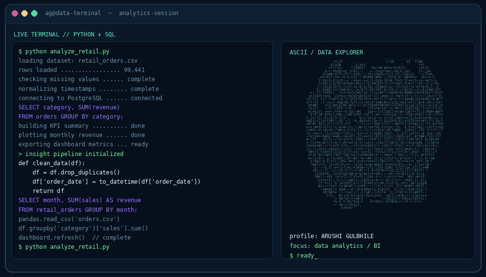

<!-- ====================================================== -->
<!--  AG | GITHUB PROFILE README                             -->
<!--  Put this file + the /assets folder in the repo:        -->
<!--  github.com/ARUSHIGULBHILE/ARUSHIGULBHILE               -->
<!-- ====================================================== -->

<p align="center">
  
</p>

<div align="center">

<a href="https://github.com/ARUSHIGULBHILE">
  
</a>

<br/>


<br/><br/>



<br/>

<samp>01000001 01000111 &nbsp;|&nbsp; PYTHON &nbsp;|&nbsp; SQL &nbsp;|&nbsp; DATA ANALYTICS</samp>

<br/><br/>

<a href="https://github.com/ARUSHIGULBHILE"></a>
<a href="https://www.linkedin.com/in/arushi-gulbhile/"></a>


</div>

---

<h2 align="center">🌟 About Me</h2>

<table width="100%" align="center">
  <tr>
    <td width="58%" valign="top">
      <h3>👩‍💻 Professional Journey</h3>
      <ul>
        <li>🎓 Pursuing <strong>B.E. in Computer Engineering</strong> at <strong>Zeal College of Engineering &amp; Research, Pune</strong></li>
        <li>📊 Focused on <strong>Python</strong>, <strong>SQL</strong>, <strong>Excel</strong>, <strong>Power BI</strong> &amp; business analytics</li>
        <li>🐍 Exploring data cleaning, EDA &amp; visualization with <strong>Pandas</strong> and <strong>NumPy</strong></li>
        <li>🛠️ Learning by building: dashboards, recommenders, full-stack &amp; AI-powered apps</li>
        <li>🎯 Working towards a career in <strong>Data Analytics &amp; Business Intelligence</strong></li>
      </ul>
    </td>
    <td width="42%" valign="top">
      <h3>🌍 Open Source</h3>
      <ul>
        <li>🏅 <strong>GirlScript Summer of Code 2026</strong></li>
        <li>🔀 <strong>8</strong> merged pull requests</li>
        <li>📦 Contributions across <strong>6</strong> repositories</li>
        <li>🌐 Reported global contributor rank <strong>#840</strong></li>
        <li>🧩 Active in <a href="https://github.com/ARUSHIGULBHILE/commitpulse">CommitPulse</a></li>
      </ul>
    </td>
  </tr>
</table>

```python
class Arushi:
    def __init__(self):
        self.role = "Computer Engineering Student"
        self.focus = "Data Analytics"
        self.languages = ["Python", "SQL"]
        self.tools = ["Pandas", "Power BI", "Excel", "PostgreSQL"]
        self.interests = ["Business Intelligence", "Data Visualization",
                          "Open Source", "Building Useful Products"]

    def mindset(self):
        return "Learn by building. Improve by experimenting."

me = Arushi()
```

---

<h2 align="center">🚀 My Tech Stack</h2>

<table align="center" width="100%">
  <tr>
    <th align="center" width="50%">📊 Data Analytics &amp; BI</th>
    <th align="center" width="50%">🗄️ Databases &amp; Tools</th>
  </tr>
  <tr>
    <td align="center" valign="top">
      <br/>
      
      
      
      
      
      
      <br/><br/>
    </td>
    <td align="center" valign="top">
      <br/>
      
      <br/>
      
      
      <br/><br/>
    </td>
  </tr>
  <tr>
    <th align="center" width="50%">🎨 Frontend</th>
    <th align="center" width="50%">⚙️ Backend</th>
  </tr>
  <tr>
    <td align="center" valign="top">
      <br/>
      
      <br/><br/>
    </td>
    <td align="center" valign="top">
      <br/>
      
      <br/><br/>
    </td>
  </tr>
</table>

<p align="center"><em>My current learning priority is Data Analytics. I keep exploring development and AI through projects.</em></p>

---

<h2 align="center">📊 Featured Projects</h2>

<table align="center" width="100%">
  <tr>
    <td width="100%" valign="top" align="center">
      <h3>📈 <a href="https://github.com/ARUSHIGULBHILE/sales-performance-analytics">sales-performance-analytics</a></h3>
      <p>Sales analytics and performance visualization: trends, key metrics and insights that make results easy to read.</p>
      
      
      
    </td>
  </tr>
</table>

<p align="center">
  <a href="https://github.com/ARUSHIGULBHILE?tab=repositories">
    
  </a>
</p>

---

<h2 align="center">🗺️ Learning Roadmap</h2>

```text
DATA ANALYTICS
├── Python
│   ├── Pandas & NumPy
│   ├── Data cleaning
│   └── Exploratory data analysis
├── SQL
│   ├── Filtering & aggregation
│   ├── Joins & subqueries
│   └── Analytical queries
├── BI & VISUALIZATION
│   ├── Excel
│   ├── Power BI dashboards
│   └── Data storytelling
├── DATABASES
│   └── PostgreSQL
└── PROFESSIONAL GROWTH
    ├── Portfolio projects
    ├── Open-source collaboration
    └── Interview preparation
```

---

<h2 align="center">📊 GitHub Stats</h2>

<div align="center">
  
  
</div>

<div align="center">
  
</div>

---

<h2 align="center">📬 Let's Connect</h2>

<p align="center">
  I'm happy to connect with fellow learners, data professionals, open-source contributors and people building useful things with technology.
</p>

<p align="center">
  <a href="https://github.com/ARUSHIGULBHILE"></a>
  <a href="https://www.linkedin.com/in/arushi-gulbhile/"></a>
  <!-- Add more when ready, e.g. email or portfolio:
  <a href="mailto:you@example.com"></a>
  <a href="https://your-portfolio.com"></a>
  -->
</p>

<p align="center">
  <samp>
    keep_learning();<br/>
    keep_building();<br/>
    turn_data_into_insights();
  </samp>
</p>

<p align="center">
  <strong>🔥 <i>"Curious mind. Analytical thinking. Code that turns questions into answers."</i></strong>
</p>


