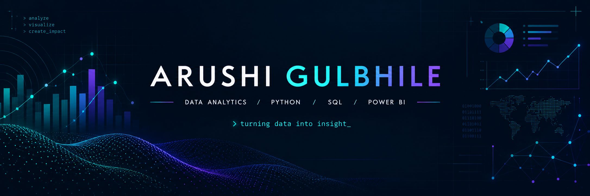

 <!-- ===================================================== -->
<!-- 1. EXISTING PROFILE BANNER -->
<!-- Keep your existing banner file at assets/profile-banner.png -->
<!-- ===================================================== -->

  

<!-- ===================================================== -->
<!-- 2. ANIMATED CODE PORTRAIT -->
<!-- Add the actual GIF at assets/portrait-preview.gif -->
<!-- ===================================================== -->

  

  <samp>01000001 01000111 · PYTHON · SQL · DATA ANALYTICS</samp>

  
  

---

<h2 align="center">Hey, I'm Arushi (AG) 👋</h2>

  <strong>Computer Engineering Student · Aspiring Data Analyst</strong>

  Turning raw data into meaningful insights, useful dashboards, and better decisions.

## 👩‍💻 About Me

- 🎓 Computer Engineering student at Zeal College of Engineering & Research, Pune.
- 📊 Focused on **Data Analytics, Business Intelligence, and data-driven problem solving**.
- 🐍 Learning and building with Python, SQL, Excel, and Power BI.
- 🔎 Interested in data cleaning, exploratory data analysis, visualization, and business insights.
- 🌱 Continuously improving through practical projects, structured learning, and open-source contributions.
- 🚀 Building a portfolio that demonstrates what I can do with real-world data.

> I believe data becomes valuable when we turn it into insights people can actually use.

## 🛠️ Tech Stack

### Languages & Querying

  
  
  
  

### Data Analysis & Visualization

  
  
  
  
  

### Databases & Developer Tools

  
  
  
  
  
  

## 📊 Featured Projects

### 01. Retail Business Intelligence & Analytics Platform

**Focus:** Retail analytics · SQL · Python · Power BI

A retail analytics project designed to transform transactional data into structured, decision-ready business insights.

- Explore retail orders, customers, products, and revenue.
- Apply Python and Pandas for data preparation and quality checks.
- Use SQL to query and analyze business data.
- Develop Power BI dashboards for exploring business performance.

**Planned analytical areas:** revenue trends, product performance, customer behavior, and order patterns.

<!-- Replace the link below with the actual repository URL -->
[View project repositories](https://github.com/ARUSHIGULBHILE?tab=repositories)

### 02. Retail Consumer Behavior Analysis

**Focus:** Customer analytics · Python · SQL · Power BI

An analytics project exploring customer purchasing patterns and consumer behavior through data cleaning, analysis, and interactive visualizations.

- Prepare and analyze customer-related datasets.
- Investigate purchasing patterns and customer segments.
- Use SQL and Python to derive analytical summaries.
- Present findings through Power BI dashboards.

[Explore my repositories](https://github.com/ARUSHIGULBHILE?tab=repositories)

### 03. More Projects & Experiments

I'm continuously expanding my portfolio with hands-on exercises, analytical experiments, and software projects that strengthen my programming and problem-solving skills.

[Browse all repositories →](https://github.com/ARUSHIGULBHILE?tab=repositories)

## 🌍 Open Source Contributions

I enjoy learning from real codebases, collaborating with maintainers, and contributing to projects beyond my own repositories.

**GirlScript Summer of Code (GSSoC) 2026**

- 🧩 Contributor across multiple repositories.
- 🔀 8 merged pull requests across 6 repositories.
- 🏅 Reported global rank: #840.
- 💻 Contributed to projects including CommitPulse.

I see open source as an opportunity to learn collaborative development, understand existing code, and make practical contributions.

[Explore my GitHub activity →](https://github.com/ARUSHIGULBHILE)

## 📈 GitHub Statistics

  
  

  

## 🎯 Currently Learning

- 📊 Data analysis and business intelligence.
- 🐍 Python for data manipulation and analysis.
- 🗄️ SQL querying and relational database concepts.
- 📈 Power BI dashboard design and data storytelling.
- ☁️ Cloud fundamentals relevant to analytics workflows.
- 🌍 Open-source collaboration and practical software development.

## 🤝 Let's Connect

I'm interested in connecting with fellow learners, data professionals, open-source contributors, and people working on meaningful projects.

  
  

  <i>Keep learning. Keep building. Let the data tell its story.</i>

  Thanks for visiting my corner of GitHub! 💚

